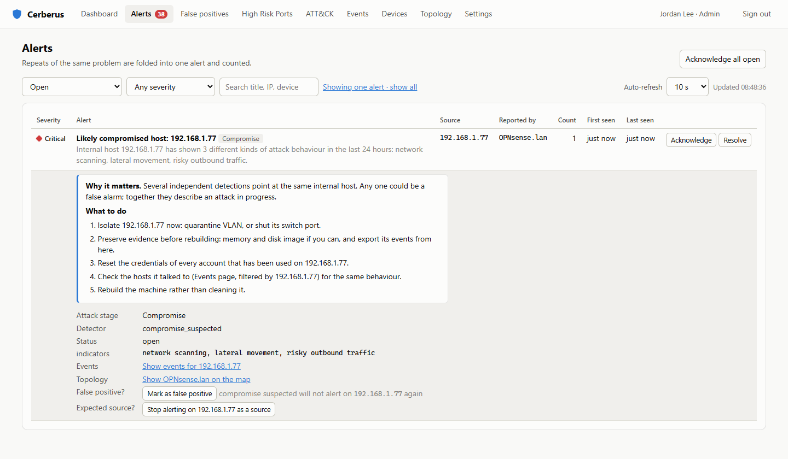
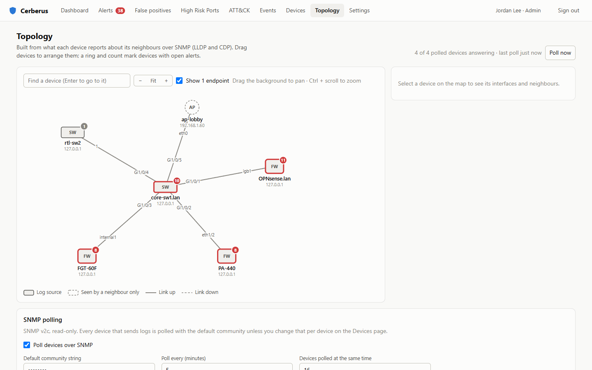
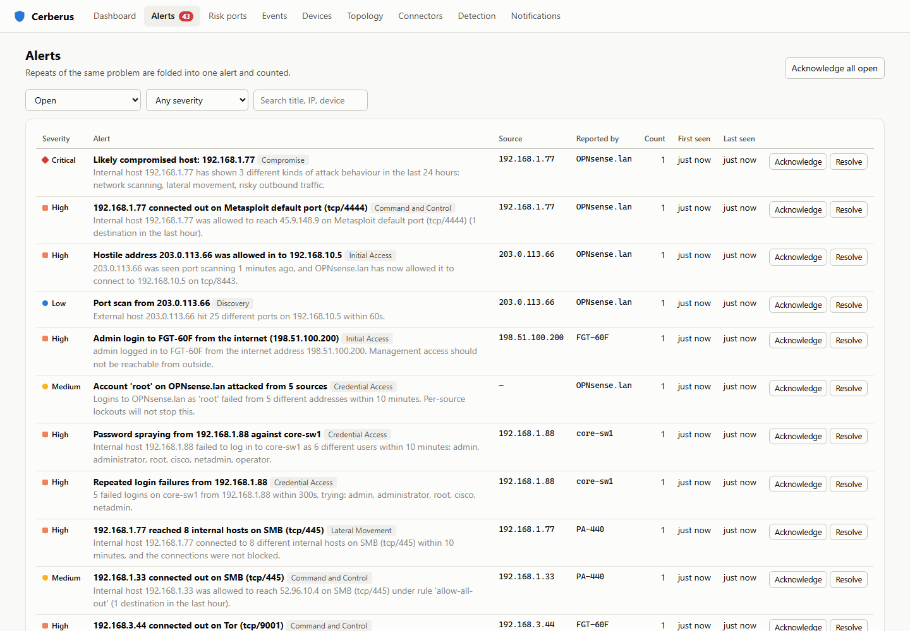
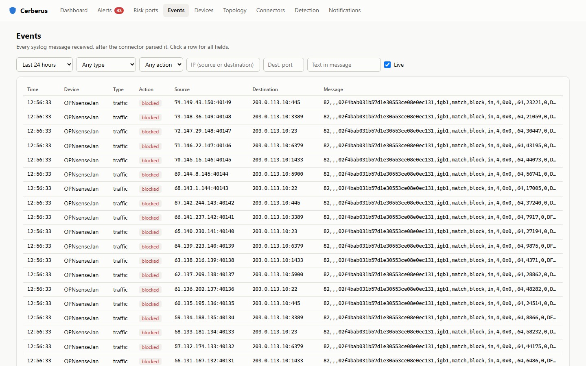
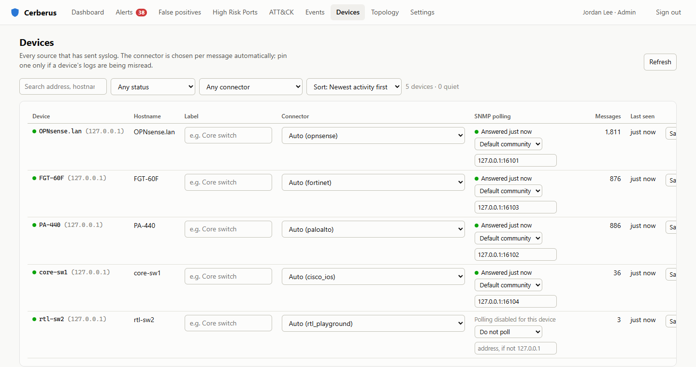
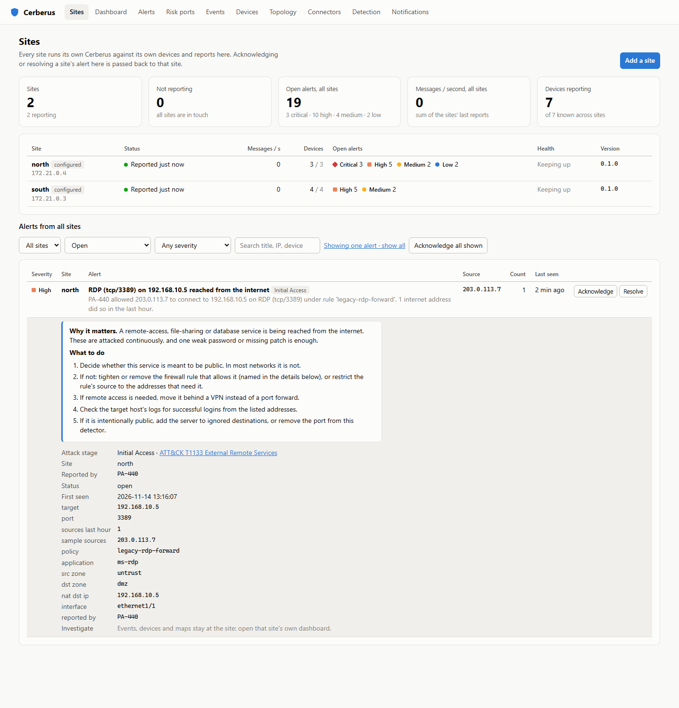

# Cerberus

A syslog watchdog for networks of up to a few hundred devices. It runs in one Docker container, receives
syslog from your firewalls and switches, looks for traffic and behaviour that is
out of the ordinary, shows it on a web dashboard, and tells you by email,
Telegram or Pushbullet. It can also poll those devices over SNMP and draw the
network topology they describe.

More documentation: [architecture](docs/ARCHITECTURE.md) ·
[HTTP API](docs/API.md) · [many sites](deploy/README.md) ·
[scaling plan](docs/CLUSTERING.md) · [security](SECURITY.md) ·
[contributing](CONTRIBUTING.md)

## Screenshots

Taken from a demo instance fed by `tools/simulate.py` and `tools/snmp_sim.py`;
every address and hostname in them is simulated.

| | |
|---|---|
| [](docs/screenshots/dashboard.png) **Dashboard**: message rate, hosts ranked by risk, alerts by attack stage | [](docs/screenshots/alert-guidance.png) **Alert**: why it matters and what to do |
| [](docs/screenshots/risk-ports.png) **Risk ports**: traffic and findings on RDP, SMB, Telnet, FTP, HTTP and others | [](docs/screenshots/topology.png) **Topology**: the map built from SNMP, with alert counts per device |
| [](docs/screenshots/alerts.png) **Alerts** | [](docs/screenshots/events.png) **Events** |
| [](docs/screenshots/devices.png) **Devices** | [](docs/screenshots/detection.png) **Detection settings** |
| [](docs/screenshots/sites.png) **Sites** (central console): every site's health and alerts in one place | |

## Quick start

```sh
# optional: choose the dashboard password and the URL used in notification links
cp .env.example .env        # then edit it

docker compose up -d --build
```

- Dashboard: `http://<host>:8080`
- Syslog: UDP and TCP port `514` on the host
- If you did not set `CERBERUS_PASSWORD`, one is generated and printed once in
  `docker logs cerberus`.

Then point your devices at the host (below) and add a channel under
**Notifications**. To see it working before you touch a real device:

```sh
python tools/simulate.py            # port scan, brute force, exposed RDP, lateral movement, C2, ...
python tools/simulate.py --list
```

### Telling devices apart

Devices are identified by the source IP of their syslog packets. Docker's bridge
network preserves that on Linux. **Docker Desktop (Windows/macOS) and rootless
Docker rewrite it**, so every device appears as one address. Either run on a
Linux host with `network_mode: host`, or set `CERBERUS_DEVICE_IDENTITY=hostname`
to identify devices by the hostname in the syslog header. See the comments in
`docker-compose.yml`.

## Pointing devices at it

**On Docker Desktop for Windows, use TCP.** UDP syslog from other machines may
never reach the container even with the port published and Windows Firewall
open (seen with OPNsense: nothing arrived over UDP, TCP worked at once). If the
dashboard's "Messages / second" stays at zero, switch the device's syslog
transport to TCP on port 514 before looking anywhere else. On a Linux host UDP
works as normal.

| Device | Where | Notes |
|---|---|---|
| **OPNsense** | System → Settings → Logging → Remote: add a destination, transport UDP(4) or TCP(4), port 514 | Leave applications empty to send everything, or pick at least *filter (filterlog)*, *audit*, *suricata*, *sshd*. Firewall rules only appear if the rule has **Log** ticked. |
| **Palo Alto (PA-440)** | Device → Server Profiles → Syslog: add the server, UDP/514, format BSD. Attach it through a Log Forwarding profile on your security rules (traffic, threat) and under Device → Log Settings (system, config). | Uses the default log format. Custom log formats need an adjusted copy of the connector. |
| **Fortinet FortiGate** | `config log syslogd setting` → `set status enable`, `set server <ip>`, `set format default` | Default key=value format only (not CSV or CEF). Traffic appears for policies with logging enabled. |
| **Cisco IOS / IOS-XE** | `logging host <ip>` and `logging trap informational` | Recommended: `service timestamps log datetime msec`, `logging origin-id hostname`, `login on-failure log`, `login on-success log`. |
| **RTL-Playground** | Enable syslog and set the server IP in the switch's CLI/config | Sends UDP only. Set a hostname on the switch so its lines carry it. |
| Anything else | Send RFC 3164 or RFC 5424 syslog | The generic connector understands OpenSSH/PAM logins, netfilter logs and common link up/down wording. Write a connector for the rest. |

## What it detects

Every threshold is editable under **Detection**, and each detector can be
switched off.

### Security detections

These look for specific attacker activity. Each alert opens with why it
matters, the MITRE ATT&CK technique, and numbered steps for a firewall or
network team; where the firewall logged it, the alert names the rule and zones
that allowed the traffic. Notifications carry the same guidance and link
straight to the alert.

| Detector | Fires when | Default |
|---|---|---|
| Sensitive service reachable from the internet | the firewall allows an internet address to an internal host on SSH, RDP, SMB, a database port, etc. (follows destination NAT) | 16 ports |
| Risky outbound connection | an internal host is allowed out on SMB, RDP, Telnet, IRC, Tor, SOCKS or common malware ports | 14 ports |
| Lateral movement | one internal host makes un-blocked administration connections to many internal hosts | 8 hosts / 10 min |
| Beaconing | an internal host contacts one internet address at near-constant intervals | 12 in a row, ≤10% variation |
| Password spraying / distributed guessing | one source tries many usernames, or one account is attacked from many sources | 6 users / 5 sources in 10 min |
| Unexpected administrative access | a device login from the internet, or from an address that has never managed that device; optionally activity outside working hours | learns for 24 h |
| Surge on a high-risk port | an hour's traffic on a watched port (RDP, SMB, Telnet, FTP, HTTP, databases, ...) is several times what that port normally carries, per direction, allowed and blocked judged separately | 4x and 100 connections, after 6 h of history |
| Watchlist match | traffic to or from addresses you list (incident IOCs, a feed you paste in) | empty |
| Threat not blocked | an IDS/threat signature fired but the device only alerted | on |
| Correlation: likely compromised host | one internal host shows three different kinds of attack behaviour in 24 h | 3 kinds |
| Correlation: hostile address allowed in | an internet address that was scanning or guessing passwords is later allowed through to an internal host | 24 h |

### Risk ports

The **Risk ports** page is a standing view of the services attackers go for
first: remote access (RDP, SSH, Telnet, VNC, WinRM), file sharing (SMB,
NetBIOS, NFS, FTP, TFTP), clear-text protocols (HTTP, POP3, IMAP, LDAP) and
databases. For each port it shows allowed connections from the internet, to
the internet and inside the network, blocked connections, a trend line, and
any open alerts that name the port. Ports with a finding are listed first:

| Finding | Meaning |
|---|---|
| Open to the internet | the firewall allowed internet addresses in on this port (web ports are marked lower: expected for a public web server) |
| Surge | traffic in one direction is well above this port's own history |
| Allowed out to the internet | SMB, RDP, Telnet, FTP and the like leaving the network (web and SSH are not flagged) |
| New sources | internal hosts that started using the port in the last 24 hours |
| Clear-text protocol in use | FTP, Telnet, POP3, IMAP or LDAP was allowed somewhere |

Click a port for why it is on the list, a chart, the busiest sources and
destinations in each direction, and links to the matching events and alerts.
Alerts that involve a port link back here. The port list and the surge
thresholds are under **Detection → High-risk port activity**; add your own
ports there. Blocked probes from the internet on these ports are constant
background noise and are counted but not treated as a finding unless they
surge.

It only knows what firewalls log: a rule without logging, and traffic that
never crosses a firewall, do not appear. Busiest sources and "new" markers are
kept in memory and start again after a restart; totals and charts are stored.

The dashboard ranks **hosts needing attention** by a risk score (severity of
each unresolved alert, weighted up when a host shows several kinds of
behaviour) and breaks alerts down by attack stage.

Expect to tune these in the first week. Add scanners, management and backup
servers to **ignored sources**; add servers that are public on purpose, and
internet services you have confirmed are legitimate, to **ignored
destinations**. An alert's detail has a one-click "stop alerting on this
source". Beaconing in particular also matches monitoring agents and update
checkers until their destinations are ignored.

What these cannot see: anything the firewall does not log (rules without
logging, traffic inside one VLAN that never crosses a firewall), the contents
of encrypted traffic, and DNS queries unless the firewall logs them as traffic
or threats. There is no geolocation or built-in threat feed; the watchlist is
whatever you paste into it.

### Anomaly and health detections

| Detector | Fires when | Default |
|---|---|---|
| Port scan | one source hits many ports on one destination | 25 ports / 60 s |
| Host sweep | one source tries one port on many hosts (blocked attempts) | 20 hosts / 60 s |
| Blocked-traffic flood | one source has a large number of connections blocked | 300 / 60 s |
| Login brute force | repeated failed logins from one source; **critical** if a success follows | 5 / 5 min |
| IDS / threat log | the device itself reports a threat (PAN-OS threat log, Suricata) | vendor severity ≥ low |
| Notable device events | port-security / DHCP-ARP inspection violations, loops, spanning-tree guards, MAC flaps, restarts, config changes, critical-level syslog | on |
| Link flapping | an interface changes state repeatedly | 6 / 5 min |
| Large outbound transfer | an internal host sends a lot to the internet (needs byte counts, e.g. PAN-OS) | 2 GB / 10 min |
| Traffic rate anomaly | a device logs far above its learned per-minute baseline, overall or blocked | 4σ, ≥3× baseline, after 30 min |
| Device went silent | a normally chatty device stops sending. Five or more within 10 minutes become one "several devices went silent together" alert | 15 min |
| New log source | an address that never sent logs before starts. More than ten within 10 minutes become one alert | quiet for the first 30 min after install |
| Topology change | a device gains or loses an LLDP/CDP neighbour between SNMP polls (needs SNMP polling) | on |

Scans, sweeps and floods from an internal address are rated higher than the
same thing from the internet, where it is background noise. Repeats of one
problem fold into a single alert with a count (30 minutes by default), and you
are notified once per alert, again only if it escalates.

**Ignored sources** (Detection → General) exempts addresses such as a
vulnerability scanner from the source-based detectors.

The rate baselines live in memory, so the rate and silence detectors warm up
again for 30 minutes after a restart.

## Topology (SNMP)

Switch it on under **Topology → SNMP polling** and enter a read-only community
string. Every device that sends logs is then polled (every 5 minutes by
default) for its identity, interfaces and LLDP/CDP neighbours, and the map is
drawn from the result:

- Solid nodes are log sources. Dashed nodes are devices that only a neighbour
  has reported - something on your network that is not sending logs here.
- A coloured ring and a count mark devices with open alerts. Click a device for
  its system details, links, and per-interface speed and traffic rate.
- Drag devices to arrange the map; positions are remembered in your browser.
- Alerts link to their device on the map.
- On a large network the map opens zoomed out to show everything. Use **+ / −
  / Fit**, Ctrl + scroll, or drag the background; type in **Find a device** and
  press Enter to jump to one.
- Phones, access points and anything else that only one switch reports and that
  sends no logs are folded away once there are more than 40 of them. Tick
  **Show endpoints** to draw them.

On each device: enable SNMP v2c with that community, allow queries from the
Cerberus host (UDP 161 outbound from the container, which Docker's default
networking permits), and enable LLDP (or CDP on Cisco). A device that does not
speak SNMP still appears if a neighbour that does can see it.

Per device, on the **Devices** page, you can use a different community, turn
polling off, or give a different address to poll (`ip` or `ip:port`) for when
the management address is not the one its syslog comes from.

Limits to know about:

- **SNMP v2c only** - no SNMPv3, and IPv4 targets only. v2c sends the community
  string unencrypted.
- Because a syslog source address can be forged, Cerberus only polls addresses
  inside the allowed networks (private ranges by default) unless you typed the
  address in yourself. Use a read-only community that is not reused elsewhere.
- Links come from LLDP and CDP, so only devices that run one of them are
  placed. Endpoints (PCs, printers) are not mapped: that needs the switches'
  MAC tables, which are not read yet.
- A neighbour has to be missing from two polls in a row before it is reported
  as gone, so "lost" alerts lag by one poll interval.
- Sixteen devices are polled at a time (adjustable). A device that keeps failing
  is retried less and less often, down to once an hour, so devices that will
  never answer do not slow the rest; the Devices page shows when the next try is.

To try it without hardware: `python tools/snmp_sim.py` starts fake agents for
the devices that `tools/simulate.py` logs as (run Cerberus with
`CERBERUS_DEVICE_IDENTITY=hostname`), then set each device's SNMP address to
the one it prints. `--rogue` adds an unexpected switch to trigger the alert.
`--sites 30` serves a 302-device campus instead.

## Many sites

For more devices than one instance handles, run one Cerberus per site and
connect them to a central console (`CERBERUS_CENTRAL=on`). Each site keeps
collecting and analysing on its own; the console shows every site's alerts,
sends the notifications, hands acknowledgements back to the sites, and alerts
when a site stops reporting. Reference deployments for Docker Compose, Docker
Swarm and Kubernetes, and the settings, are in [deploy/README.md](deploy/README.md).
The plan for clustering beyond that is in [docs/CLUSTERING.md](docs/CLUSTERING.md).

## Running at scale

Cerberus is one process and one SQLite file. That is enough for a few hundred
devices; these are the things that decide whether it is enough for yours.

**Message rate, not device count, is the limit.** Parsing and detection run on
one CPU core. On the development machine (a desktop PC) that core handled about
15,000 messages a second, and a test of the whole application with 302
simulated devices sending 6,000 a second over UDP lost none. Switches send a
few messages a minute; firewalls logging every connection send the rest.
`python tools/loadtest.py` measures your own hardware. The dashboard's
**Dropped messages** tile says when the queue overflowed, the disk is slow or a
limit was hit.

**Decide what to keep.** Every message is analysed, but storing every allowed
connection is what fills the disk: an event takes about 850 bytes.

| Average rate | Events per day | Disk per day, storing everything |
|---|---|---|
| 100/s | 8.6 million | about 7 GB |
| 1,000/s | 86 million | about 73 GB |
| 5,000/s | 432 million | about 370 GB |

The default cap of 2,000,000 events is about 1.7 GB, and at 1,000 messages a
second that is 33 minutes of history. The dashboard's **Searchable history** tile
shows how far back your events actually go. To make it longer:

- Raise `CERBERUS_MAX_EVENTS` to what your disk allows. Events are stored in
  segments of up to 250,000, and only the newest is written to, so writing does
  not get slower as more is kept (in the load test it took the same time per
  batch with 1.25 million events stored as with none). Old segments are dropped
  whole, so the total can run up to two segments over the cap.
- Set `CERBERUS_TRAFFIC_SAMPLE=20` to store one allowed connection in twenty, or
  `0` to store none. Blocked traffic, threats, logins and device events are
  always stored, and the detectors still see every message, so alerts are
  unaffected - but the Events page then shows only a sample of ordinary traffic.
- Turn off logging of allowed traffic on firewall rules where you do not need
  it. Note that exposure, lateral-movement, beaconing and data-transfer
  detection all depend on allowed-traffic logs.

Alerts are small and kept for 90 days regardless.

**Searches stay fast when they name something.** A device, an address or a port
is found through an index whatever the table size. Free-text search has to read
every event in the chosen time range, so keep the range short; a search still
running after 10 seconds is stopped rather than left to slow everyone else down.

**Network settings.**

- UDP syslog is lost silently if the kernel's receive buffer fills during a
  burst. Cerberus asks for 4 MB; Linux grants at most `net.core.rmem_max`, so on
  the Docker host run `sysctl -w net.core.rmem_max=8388608` (and persist it).
- Run on Linux with `network_mode: host` or the default bridge so each device
  keeps its own source address (see [Telling devices apart](#telling-devices-apart)).
- Devices that send syslog over TCP hold a connection open each:
  `CERBERUS_MAX_TCP_CLIENTS` (default 1,000).

**What grows with the estate, and how it is kept in check.**

- One device or site going down, or a rollout of new devices, raises one alert
  that counts the devices rather than one alert each.
- The Devices page filters by status, connector and text, and sorts by longest
  quiet; SNMP polling runs sixteen devices at a time and backs off from ones
  that do not answer.
- Up to 5,000 log sources are tracked. Beyond that new sources are ignored (and
  the dashboard says so), which also bounds what forged source addresses can do.

**When to use something else.** If you need months of every flow searchable, or
sustained rates beyond what one core parses, put a log platform (a SIEM or a
syslog pipeline with its own storage) in front and send Cerberus the firewall
and switch logs you want analysed. There is no clustering or high availability:
one container, one data volume.

## Notifications

Add channels in the UI; each has a minimum severity and a **Send test** button.

- **Email (SMTP)**: server, port, STARTTLS/SSL/none, optional login, any number of recipients.
- **Telegram**: create a bot with @BotFather, send it a message, and use the bot token plus your chat ID (several IDs may be comma-separated; group IDs work too).
- **Pushbullet**: an access token from your account settings; optionally an email or channel tag to target.

A channel sends at most 10 notifications a minute; anything beyond that arrives
as one "N more alerts" summary. Credentials are stored in the SQLite database in
the data volume and are never returned by the API.

## Connectors

A connector is a YAML file that turns one vendor's log text into normalised
fields. Built-ins are in `cerberus/connectors_builtin/`. Put your own in the
`connectors/` folder of the data volume (a file with the same `id` replaces a
built-in), then press **Reload definitions** on the Connectors page. That page
also has a box to paste a raw log line and see exactly how it parses.

```yaml
id: my_switch
name: My switch
priority: 50              # lower is tried first; generic is 1000
match:                    # claim a message if ANY of these regexes matches
  app: ['^myswitchd$']    # fields: app, hostname, message, raw (everything after <PRI>)
  message: ['^PORT-']
rules:                    # first rule that applies wins
  - name: link
    pattern: 'PORT-(?P<interface>\d+) link (?P<state>up|down)'   # parser: regex (default)
    set: {event_type: link_state}

  - name: firewall
    when: {app: '^fw$'}   # optional precondition; ALL listed fields must match
    parser: csv
    columns: [action, proto, src_ip, src_port, dst_ip, dst_port]   # null skips a column
    set: {event_type: traffic}
    map: {action: {permit: allow, _default: block}}                # translate values
```

Parsers: `regex` (named groups), `csv` (`columns` in order and/or `fields:
{name: index}`, plus nested `switch: {field: <name>, cases: {...}, default:
{...}}` layouts and `extract` to regex a column), `kv` (`key=value` pairs, with
`rename`), `json` (with `rename`). Any rule can add `extract: [{from: <field>,
patterns: [...]}]` to pull named groups out of a field it already parsed, as
the Fortinet connector does to get the client address out of `ui="ssh(10.0.0.5)"`. `source: raw` runs a rule against the text
before the header was stripped.

Fields the detectors use:

| Field | Values |
|---|---|
| `event_type` | `traffic`, `threat`, `auth_failure`, `auth_success`, `link_state`, `config_change`, `security_violation`, `stp_guard`, `loop_detected`, `mac_flap`, `stp_change`, `system_restart`, `system`, or anything else (stored, not analysed) |
| `action` | `allow` or `block` |
| `src_ip`, `dst_ip`, `src_port`, `dst_port`, `proto`, `bytes` | traffic details |
| `user`, `interface`, `state`, `hostname` | context |
| `level` | vendor importance: `info`, `low`, `medium`, `high`, `critical` |

Any other captured name is kept with the event and shown in the UI.

If a device's logs are attributed to the wrong connector, pin one on the
**Devices** page.

## Configuration

| Variable | Default | |
|---|---|---|
| `CERBERUS_PASSWORD` | generated | Dashboard password |
| `CERBERUS_AUTH` | `on` | `off` disables the login (only behind your own authenticating proxy) |
| `CERBERUS_PUBLIC_URL` | | Base URL for links in notifications |
| `CERBERUS_DEVICE_IDENTITY` | `ip` | `ip` or `hostname` |
| `CERBERUS_RETENTION_DAYS` | `7` | How long events are kept |
| `CERBERUS_MAX_EVENTS` | `2000000` | Hard cap on stored events (see [Running at scale](#running-at-scale)) |
| `CERBERUS_TRAFFIC_SAMPLE` | `1` | Store one in N *allowed* traffic events; `0` stores none. Detection still sees all of them |
| `CERBERUS_MAX_TCP_CLIENTS` | `1000` | Syslog-over-TCP connections accepted at once |
| `CERBERUS_ALERT_RETENTION_DAYS` | `90` | |
| `CERBERUS_SYSLOG_UDP_PORT` / `_TCP_PORT` | `5514` | Inside the container; `0` disables |
| `CERBERUS_WEB_PORT` | `8080` | |
| `CERBERUS_DATA_DIR` | `/data` | SQLite database and user connectors |
| `CERBERUS_PASSWORD_FILE` | | Read the password from a file instead (Docker and Kubernetes secrets) |
| `CERBERUS_CENTRAL_URL`, `CERBERUS_CENTRAL_TOKEN[_FILE]`, `CERBERUS_SITE_NAME`, `CERBERUS_CENTRAL_CA` | | Report to a central console (see [deploy/README.md](deploy/README.md)) |
| `CERBERUS_CENTRAL`, `CERBERUS_SITE_TOKENS_FILE`, `CERBERUS_SITE_SILENT_MINUTES` | `off`, , `5` | Act as the central console |

## Security notes

- Syslog is unauthenticated and unencrypted. Keep port 514 reachable only from
  your management network; anyone who can reach it can inject log lines (and so
  alerts). There is no TLS syslog listener.
- The dashboard speaks plain HTTP. Put it behind a TLS reverse proxy if it is
  reachable from anywhere you do not trust.
- The container runs as an unprivileged user.

## Development

```sh
python -m venv .venv && .venv/bin/pip install -r requirements.txt pytest   # Windows: .venv\Scripts\pip
.venv/bin/python -m pytest
CERBERUS_PASSWORD=dev .venv/bin/python -m cerberus       # syslog on 5514, UI on 8080
python tools/simulate.py --port 5514
python tools/loadtest.py                                  # throughput and query times for 300 devices
```

Layout: `receiver.py` (UDP/TCP listeners) → `syslog_parser.py` (envelope) →
`connectors.py` (YAML definitions) → `detectors.py` + `security.py` → `engine.py` (pipeline,
alert folding, batching to SQLite) → `notifiers.py` and `web.py` + `static/`.
Alongside: `snmp.py` (a small v2c client) → `snmp_poller.py` → `topology.py`.
The wording of every alert's guidance lives in `playbooks.py`; `riskports.py` is the high-risk port
tracker and its list of services.

## Licence

Apache License 2.0: see [LICENSE](LICENSE). You may use, modify and
redistribute Cerberus, including commercially and inside your organisation,
without charge. Keep the licence and the [NOTICE](NOTICE) file with copies you
distribute, and mark files you change. The licence includes a patent grant and
comes with no warranty.
